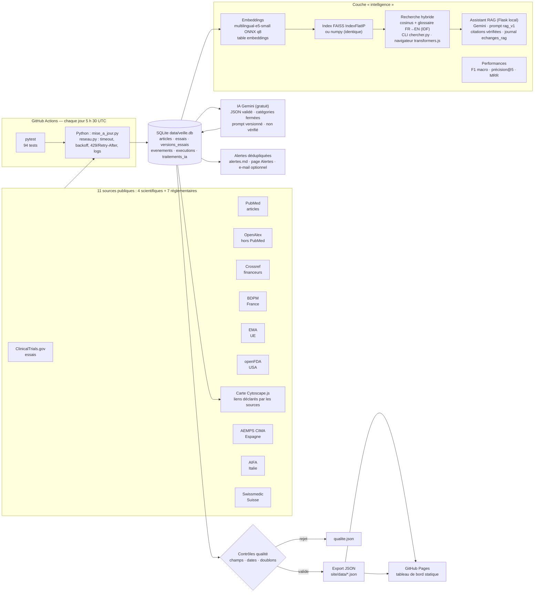

# Architecture de la veille glaucome

Chaîne de traitement, de la collecte à la publication. Le même schéma existe en image : [architecture.svg](architecture.svg).

## Rôle de chaque brique

| Brique | Fichier(s) | Ce qu'elle garantit |
|---|---|---|
| Connecteurs | `veille/sources/*.py` | un module par source, données normalisées, « on n'invente rien » |
| Réseau robuste | `veille/reseau.py` | timeout, tentatives limitées, backoff exponentiel, 429 + Retry-After, logs `data/logs/` |
| Orchestration | `mise_a_jour.py` | une étape par source ; une panne → exécution **partielle**, pas d'arrêt |
| Stockage | `veille/base.py`, `data/veille.db` | déduplication par clés uniques (PMID, DOI, OpenAlex, NCT), versions, événements, journal |
| IA traçable | `veille/resumer_ia.py`, `config/prompts/` | sortie JSON validée, modèle + version du prompt + date + statut de validation |
| Évaluation | `eval/jeu_etiquete.csv`, `eval/evaluer.py` | matrice de confusion, F1 macro sur 30 articles étiquetés à la main |
| Contrôles qualité | `veille/export.py` | aucune donnée invalide publiée ; rejets listés dans `qualite.json` |
| Alertes | `veille/alertes.py` | un événement = une alerte, jamais deux fois |
| Embeddings + index | `veille/semantique.py`, `data/index/` | modèle local gratuit, incrémental ; FAISS ou numpy (résultats identiques) |
| Recherche | `chercher.py`, `site/recherche.html` | hybride (cosinus + glossaire IDF), score détaillé, même modèle en Python et dans le navigateur |
| Assistant RAG | `assistant.py`, `veille/rag.py`, `config/prompts/rag_v1.md` | réponse uniquement depuis les extraits ; citations vérifiées ; journal |
| Carte | `veille/graphe.py`, `site/carte.html` | aucun lien déduit : uniquement des données déclarées |
| Performances | `eval/`, `site/performances.html` | F1 macro, précision@5, MRR sur jugements humains |
| Tests | `tests/` | 94 tests ; bloquent la publication en cas d'échec |
| Publication | `.github/workflows/` | tests → collecte → IA → export → commit → GitHub Pages |
